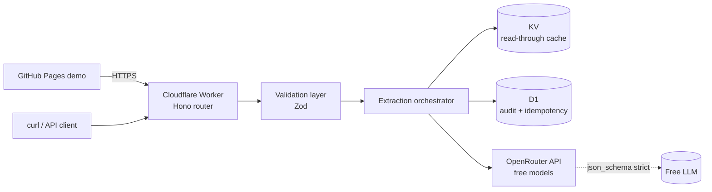
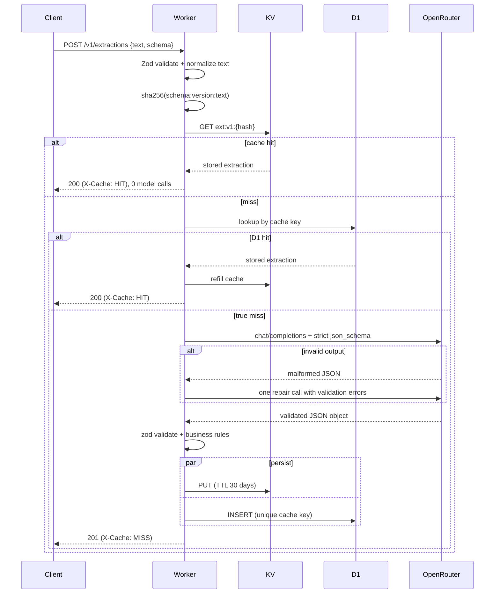

# Structured Extraction API

A zero-cost, backend-first portfolio project: an HTTP API that turns messy text (resumes and job postings) into **validated, schema-conforming JSON**.

Built with **TypeScript + Hono on Cloudflare Workers**, **D1** for persistence, **KV** for caching, and **free OpenRouter models** for inference. A small static demo page is served from GitHub Pages.

> The AI is a dependency, not the project. The project is the contract: validation, caching, idempotency, retries, and error semantics.

**Live API:** `https://structured-extraction-api.bhalder.workers.dev` · seeded with 7 cached demo fixtures.
**Live demo:** `https://biswajit-halder.github.io/structured-extraction-api/` (GitHub Pages, `gh-pages` branch).

---

## What it does

```bash
curl -s -X POST https://structured-extraction-api.bhalder.workers.dev/v1/extractions \
  -H 'Content-Type: application/json' \
  -d '{
    "schema": "resume",
    "text": "Jane Doe\njane@example.com\nNode.js developer, 2023-01 to 2024-06 at Acme."
  }'
```

```json
{
  "id": "ext_01j...",
  "schema": "resume",
  "schemaVersion": "1.0.0",
  "data": {
    "full_name": "Jane Doe",
    "email": "jane@example.com",
    "skills": ["node.js"],
    "experience": [
      { "company": "Acme", "role": "Node.js developer", "start": "2023-01", "end": "2024-06", "months": 18 }
    ],
    "total_experience_months": 18,
    "confidence": 0.92
  },
  "meta": {
    "cached": false,
    "cacheSource": "llm",
    "model": "nvidia/nemotron-3.5-lightning:free",
    "tokens": { "prompt": 612, "completion": 181 },
    "latencyMs": 1432,
    "repairAttempts": 0
  }
}
```

Repeat the exact same request → `200` with `X-Cache: HIT` and **zero** model calls.

---

## Architecture





---

## Designing for a 50 requests/day budget

Free OpenRouter models allow roughly **50 requests/day** (20/min). The whole design exists to respect that:

| Technique | Effect |
|---|---|
| **Hash cache** — `sha256(schema : version : normalized text)` in KV, with D1 as read-through fallback | Repeat requests cost 0 calls forever (until 30-day KV TTL) |
| **Schema version in the hash** | Bumping the schema invalidates old entries automatically |
| **Idempotency key** stored uniquely in D1 | Client retries never re-call the model |
| **Batch endpoint** — 5 documents, 1 LLM call | 5× better quota efficiency |
| **Seed fixtures** via `POST /admin/seed` | Live demo runs on cached data |
| **One bounded repair retry** | No infinite loops burning quota |
| **Stale-on-429** | Serve an older cached result instead of failing |
| **Provider fallback chain** | If one free model is down, try the next |
| **Mocked tests** | Full suite runs offline, costs nothing |

Free models change often. Pick current ones at https://openrouter.ai/models?max_price=0 and update `DEFAULT_MODEL` / `FALLBACK_MODELS` in `wrangler.toml`.

Structured outputs are **per endpoint**, not guaranteed per model. The request sets `provider.require_parameters: true`, and Zod remains the real source of truth at the application boundary.

---

## API

Full spec in [`openapi.yaml`](./openapi.yaml).

| Method | Path | Purpose |
|---|---|---|
| `GET` | `/health` | Liveness |
| `GET` | `/v1/schemas` | List schemas + their JSON Schema |
| `GET` | `/v1/schemas/fixtures` | Curated demo inputs |
| `POST` | `/v1/extractions` | Extract one document |
| `POST` | `/v1/extractions/batch` | Extract up to 5 documents in one call |
| `GET` | `/v1/extractions/:id` | Fetch stored result |
| `POST` | `/admin/seed` | Seed fixtures (needs `x-admin-token`) |

Error envelope:

```json
{ "error": { "code": "VALIDATION_ERROR", "message": "Invalid extraction request", "details": [] } }
```

Codes: `VALIDATION_ERROR` 400 · `UNKNOWN_SCHEMA` 400 · `PAYLOAD_TOO_LARGE` 413 · `NOT_FOUND` 404 · `RATE_LIMITED` 429 · `QUOTA_EXCEEDED` 402 · `UPSTREAM_ERROR` 502 · `UNPROCESSABLE_EXTRACTION` 422 · `INTERNAL` 500.

---

## Local setup

```bash
npm install
cp .dev.vars.example .dev.vars      # fill OPENROUTER_API_KEY + ADMIN_TOKEN
npx wrangler login
npx wrangler d1 create structured-extraction-db     # paste id into wrangler.toml
npx wrangler kv namespace create CACHE              # paste id into wrangler.toml
npx wrangler d1 execute structured-extraction-db --local --file=./migrations/0001_init.sql
npm run dev
```

```bash
curl -X POST http://localhost:8787/admin/seed \
  -H 'x-admin-token: <your ADMIN_TOKEN>'
```

---

## Deployment (free)

```bash
npx wrangler d1 execute structured-extraction-db --remote --file=./migrations/0001_init.sql
npx wrangler secret put OPENROUTER_API_KEY
npx wrangler secret put ADMIN_TOKEN
npm run deploy
```

Then seed:

```bash
curl -X POST https://YOUR_WORKER.workers.dev/admin/seed \
  -H 'x-admin-token: <your ADMIN_TOKEN>'
```

The admin token is stored only as a Worker secret and in the gitignored `.dev.vars`. Rotate with `wrangler secret put ADMIN_TOKEN` if it is ever exposed.

The static demo in `demo/` is published from the `gh-pages` branch via GitHub Pages (Settings → Pages → Deploy from a branch). After changing demo files, copy `demo/*` to the root of `gh-pages` and push that branch. Set the API base URL in the demo page to your Workers URL. Set `ALLOWED_ORIGIN` in `wrangler.toml` to your `https://USERNAME.github.io` origin for production CORS (the default `*` is convenient for local testing).

---

## Project structure

```
src/
  index.ts                 app bootstrap, routes, CORS
  routes/                  extractions, schemas, admin
  schemas/                 zod schemas, JSON Schema generation, registry
  services/                llm adapter, extraction orchestrator, prompts
  db/                      D1 queries + row mapping
  middleware/              errors, rate limiting
  lib/                     hashing, JSON parsing, ids, error classes
  fixtures/                demo inputs
demo/                      static GitHub Pages demo
test/                      35 unit + route tests (fully mocked)
migrations/                D1 schema
openapi.yaml
```

---

## Tests

```bash
npm test           # 35 tests, no network, no API key
npm run typecheck
npm run dev
```

Tests cover cache hits, model calls, the bounded repair path, 422 on failed repair, stale-on-429, idempotency, batch fan-out, strict schema generation, provider fallback, quota errors, and route validation.

---

## Interview talking points

- **Why Zod is the source of truth** even when the model is constrained by JSON Schema (provider support is per-endpoint; never trust the network).
- **Why the cache key includes the schema version** (automatic invalidation on contract changes).
- **What happens on 429 / 402 / malformed JSON / timeout** — see the sequence diagram.
- **Why there is no chat UI** — deterministic contracts are the product.
- **What changes at scale** — durable rate limiting (Cloudflare Rate Limiting API), semantic vector cache, queue-backed long documents, per-user API keys, model-quality eval harness.

---

## Cost

$0. OpenRouter `:free` models · Cloudflare Workers/D1/KV free tiers · GitHub Pages · GitHub Actions. No credit card required.
